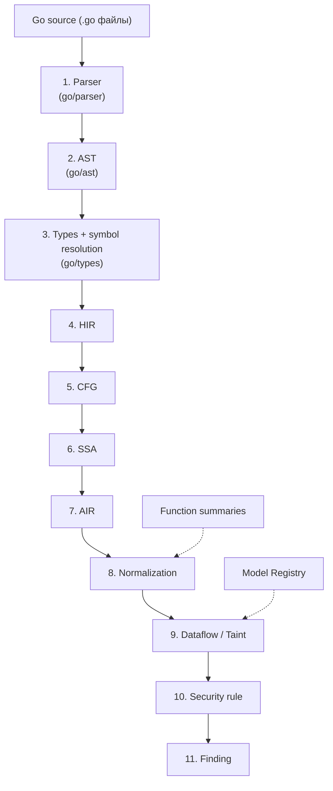
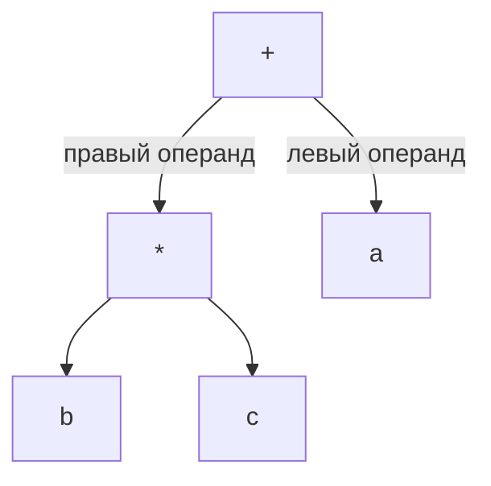
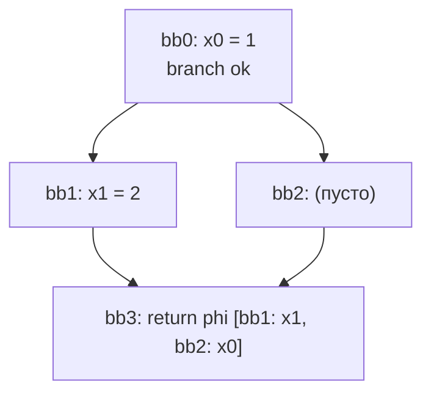
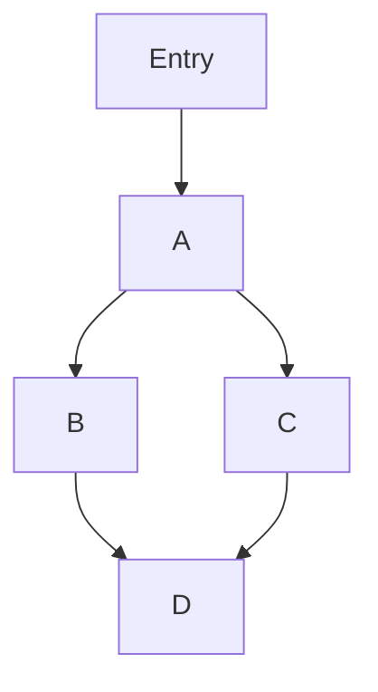
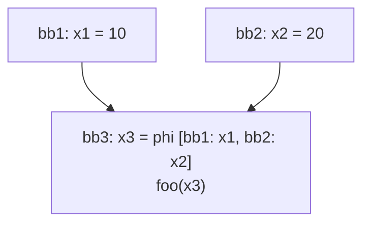
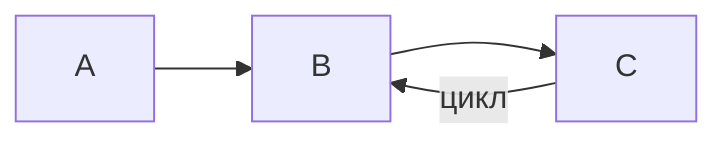

# SQL Injection Detector

**SQL Injection Detector** — SAST-инструмент (Static Application Security Testing — статический анализ безопасности), который ищет SQL-инъекции в Go-коде.

Главная идея: **прежде чем анализировать код, программу стоит упростить**. Реальный код обрастает множеством абстракций, структурами и промежуточными функциями. Если анализировать его «как есть», анализ тонет в деталях. Если сначала всё свернуть до сути, анализ становится прямолинейным.

## Оглавление

- [Исследовательский вопрос](#исследовательский-вопрос)
    - [Гипотеза](#гипотеза)
    - [Методология](#методология)
- [Конвейер анализа](#конвейер-анализа)
- [Этапы конвейера](#этапы-конвейера)
    - [1. Parser](#1-parser)
    - [2. AST](#2-ast)
    - [3. Types и symbol resolution](#3-types-и-symbol-resolution)
    - [4. HIR](#4-hir)
    - [5. CFG](#5-cfg)
    - [6. SSA](#6-ssa)
    - [7. AIR](#7-air)
    - [8. Normalization](#8-normalization)
    - [9. Dataflow / Taint](#9-dataflow--taint)
    - [10. Security rule](#10-security-rule)
    - [11. Finding](#11-finding)
- [Что входит в v1](#что-входит-в-v1)
- [Ограничения](#ограничения)
- [Почему свой IR, а не готовые решения](#почему-свой-ir-а-не-готовые-решения)
- [Смежные инструменты](#смежные-инструменты)
- [Литература и ссылки](#литература-и-ссылки)
- [Глоссарий](#глоссарий)
- [Открытые вопросы](#открытые-вопросы)
- [Лицензия](#лицензия)

Каждый этап конвейера опирается на предыдущий, поэтому документ читается сверху вниз. Если вы новичок в статическом анализе — это нормально, все понятия вводятся с нуля.

## Исследовательский вопрос

### Гипотеза

> **Предварительная нормализация внутреннего представления программы помогает анализатору находить уязвимости при росте структурной сложности кода.**

«Структурная сложность» — это слои абстракций между источником данных и опасной операцией: промежуточные функции, обёртки, структуры-передатчики. Чем их больше, тем сложнее анализатору, который пытается идти по коду напрямую. Мы проверяем, что нормализация устраняет эту деградацию.

### Методология

Чтобы утверждение было проверяемым, а не декларативным, эксперимент строится так:

1. **Метрика сложности.** Для каждого тестового примера измеряем: длину цепочки вызовов source → sink, число промежуточных функций-обёрток, размер CFG.
2. **Бейзлайн.** Один и тот же taint-анализ запускается в двух режимах: без нормализации и с нормализацией. Меняется ровно одна переменная — это делает сравнение честным.
3. **Корпус.** Синтетические примеры (от простых до глубоко вложенных, с 5–10+ слоями обёрток) плюс стандартные наборы уязвимого кода (OWASP Benchmark, Juliet Test Suite).
4. **Метрики результата.** Recall (нашли ли уязвимость), precision (сколько ложных срабатываний), размер графа и число итераций до fixed point.
5. **Критерий успеха.** При росте сложности recall без нормализации падает, с нормализацией — держится, и precision не деградирует.

## Конвейер анализа



Номера в узлах совпадают с номерами разделов ниже. Пунктиром показаны вспомогательные сущности, которые не этапы, а данные, питающие этапы:

- **Function summaries** — предвычисленные «сводки» о поведении функций (нужны normalization для inlining).
- **Model Registry** — каталог источников и стоков стандартной библиотеки (нужен taint-анализу).

## Этапы конвейера

### 1. Parser

Parser разбирает текст программы и понимает его синтаксическую структуру.

Например, выражение:

```go
a + b * c
```

превращается в дерево. Важно, что `*` связывает свои операнды сильнее, чем `+`, поэтому `b * c` — единое подвыражение:



Заметьте: приоритет операций (`*` выше, чем `+`) уже учтён в форме дерева — parser понял не только _какие_ символы написаны, но и _как они группируются_.

В Go для этого есть библиотека [`go/parser`](https://pkg.go.dev/go/parser).

### 2. AST

AST — Abstract Syntax Tree, абстрактное синтаксическое дерево. AST показывает, как написана программа: какая операция, над какими подвыражениями, внутри какого вызова.

Например:

```go
x := foo(a + b)
```

в терминах `go/ast` становится:

```text
AssignStmt
├── Lhs: [Ident "x"]             // слева от :=
└── Rhs: [CallExpr]              // справа от :=
        ├── Fun:  Ident "foo"    // что вызываем
        └── Args: [BinaryExpr +] // аргументы
                ├── X: Ident "a"
                └── Y: Ident "b"
```

Здесь `AssignStmt`, `CallExpr`, `BinaryExpr`, `Ident` — реальные типы узлов пакета `go/ast`. (В `go/ast` у присваивания списки `Lhs`/`Rhs`, а не одиночные значения — так устроен пакет, поддерживающий множественное присваивание вида `a, b = b, a`.)

AST хорошо отражает синтаксис, но для серьёзного анализа потоков данных его недостаточно, в нём много синтаксического шума (скобки, позиции, детали записи).

В Go для этого есть библиотека [`go/ast`](https://pkg.go.dev/go/ast).

### 3. Types и symbol resolution

Чтобы сделать выводы о безопасности, недостаточно увидеть вызов

```go
db.Query(...)
```

Нужно понять, что это именно `database/sql.(*DB).Query` — метод структуры `*sql.DB` из пакета [`database/sql`](https://pkg.go.dev/database/sql), а не одноимённая функция из чужого пакета. Тут нужны type checking и symbol resolution. Анализатор выясняет:

1. Какой тип у переменной?
2. Какое именно объявление используется?
3. Какая функция вызывается?
4. Какой метод принадлежит какому типу?

В Go для этого есть библиотека [`go/types`](https://pkg.go.dev/go/types).

### 4. HIR

Сначала — что такое IR?

IR — Intermediate Representation, промежуточное представление. Это внутренний формат программы, на котором работает анализ. Все следующие этапы конвейера оперируют IR, а не исходным текстом.

Зачем нужен именно **HIR** (High-level IR, высокоуровневое IR)? HIR сохраняет высокоуровневую структуру программы — функции, условия, циклы, вызовы, — но уже не зависит от деталей `go/ast`. Сравните: два синтаксически разных фрагмента

```go
x := a + (b * c)
```

```go
x := a + b * c
```

после HIR — одно и то же:

```text
Assign { target: x, value: Add(a, Mul(b, c)) }
```

Скобки, позиции в файле, форма записи — всё это синтаксический шум, и HIR его уже не содержит. При этом структура «функция → инструкции» сохранена, в отличие от более низких представлений ниже по конвейеру.

Зачем это нам: после перехода на HIR анализ окончательно перестаёт зависеть от `go/ast`, а мы получаем компактное и полностью подконтрольное представление, из которого удобно строить CFG и SSA.

### 5. CFG

CFG — Control Flow Graph, граф потока управления. Это граф всех возможных переходов управления внутри функции: в каком порядке могут выполняться участки кода.

Например:

```go
x := 1

if ok {
    x = 2
}

return x
```

выглядит как:



Узлы такого графа называются basic blocks.

#### Basic block

Basic block — последовательность инструкций без внутреннего ветвления: если выполнение вошло в начало блока, оно дойдёт до его конца.

Например:

```text
bb0:
    a = x + 1
    b = foo(a)
    c = b + 2
    return c
```

В конце блока находится terminator — инструкция, завершающая блок:

- jump (безусловный переход)
- branch (условный переход в один из двух блоков)
- return (выход из функции)

#### Dominators

Построить CFG — полдела, надо ещё понять его структуру.

Говорят, что блок **A доминирует** над блоком B, если любой путь от входа функции до B обязательно проходит через A.



Здесь A доминирует над B, C и D: минуя A, до них не добраться.

Из отношения доминирования строится dominator tree. Также вычисляется dominance frontier — граница доминирования блоков.

Для проекта главное практическое значение dominance frontier: она говорит, **где нужно вставить phi-узлы при построении SSA** (см. этап 6). Это классический приём из статьи Cytron и соавторов (ссылка в [Литературе](#литература-и-ссылки)).

### 6. SSA

SSA — Static Single Assignment. Это форма программы, в которой каждая переменная получает значение **ровно один раз**.

Исходный код:

```go
x := 1
x = x + 1
x = x * 2
```

в SSA:

```text
x0 = 1
x1 = x0 + 1
x2 = x1 * 2
```

Теперь `x0`, `x1`, `x2` — три разных значения, и каждое определено один раз. Отслеживать, «откуда пришло это значение», становится тривиально: у каждого значения ровно одно определение. Это фундамент для анализа зависимостей и taint-анализа.

#### PHI

Проблема появляется на ветвлениях. Например:

```go
if cond {
    x = 10
} else {
    x = 20
}

foo(x)
```

После SSA:



или в тексте:

```text
bb1:
    x1 = 10

bb2:
    x2 = 20

bb3:
    x3 = phi [bb1: x1, bb2: x2]
    foo(x3)
```

`phi` показывает: значение зависит от того, по какой ветке выполнение пришло в этот блок. Пришли из `bb1` — работаем с `x1`, из `bb2` — с `x2`. Это не настоящая функция программы, а служебная конструкция SSA.

#### ValueID

После SSA мы всё меньше думаем в терминах «переменная x» и всё больше — «конкретное значение %17»:

```text
%1 = HTTP_SOURCE()
%2 = concat("SELECT ", %1)
%3 = call DB.Query(%2)
```

Каждый `%N` — отдельный ValueID, уникальный идентификатор значения. Именно ValueID станут единицами, между которыми taint-анализ будет распространять метки.

### 7. AIR

К этому моменту у нас уже есть CFG и SSA. Логичный вопрос: **зачем ещё одно представление?**

AIR — Analysis Intermediate Representation (проектный термин, не общепринятый) — это единая структура данных, в которой всё предыдущее собрано вместе и готово к работе:

- плоский список базовых блоков (из CFG);
- внутри блоков — инструкции, каждая либо определяет значение с уникальным ValueID (из SSA), либо завершает блок (terminator);
- фиксированный словарь операций: call, concat, make_struct, get_field, constants, phi.

Смысл в том, что CFG и SSA — это _соглашения_, а не объекты, с которыми можно работать напрямую: «у значения одно определение», «вот как связаны блоки». А taint-анализу нужно одновременно: ходить по блокам, для каждого значения знать его определение и понимать смысл каждой инструкции. AIR складывает всё это в один объект, чтобы каждому следующему этапу не пришлось собирать это заново.

Простая проверка: попробуйте прогнать taint-анализ прямо по AST или HIR — и вы упрётесь в вопросы, на которые эти представления не отвечают. `id` присваивался дважды — какое значение течёт дальше? `if` уводит управление в две стороны — куда именно? В AST ответы спрятаны в дереве синтаксиса. AIR отвечает на оба: значения пронумерованы (`%1`, `%3`), ветвления стали явными рёбрами (`branch %2 → bb1, bb2`), слияния — phi.

Почему AIR — свой, а не готовый: [`golang.org/x/tools/go/ssa`](https://pkg.go.dev/golang.org/x/tools/go/ssa) даёт готовый SSA для Go, но покрывает весь язык — включая то, что мы сознательно не поддерживаем (см. [Ограничения](#ограничения)), — и не даёт контроля над словарём операций и ValueID. Свой AIR содержит ровно те операции, которые умеет анализатор, и крючки для normalization и трейсов. Подробно — в разделе [«Почему свой IR, а не готовые решения»](#почему-свой-ir-а-не-готовые-решения).

Нотация примеров далее единая:

```text
%N              — значение (ValueID)
%N = <op>       — определение значения
call f(%a)      — вызов функции
phi [bbK: %V…]  — значение, зависящее от входящего блока
```

Пример. Пусть исходный код такой:

```go
id := r.FormValue("id")
if dirty(id) {
    id = clean(id)
}
q := "SELECT * FROM users WHERE id = " + id
db.Query(q)
```

Тогда в AIR:

```text
bb0:
    %0 = parameter r
    %1 = call FormValue(%0, "id")        // HTTP source
    %2 = call dirty(%1)
    branch %2 → bb1, bb2

bb1:
    %3 = call clean(%1)                  // sanitizer
    jump bb2

bb2:
    %4 = phi [bb0: %1, bb1: %3]
    %5 = concat "SELECT * FROM users WHERE id = ", %4
    call DB.Query(%5)
    return
```

Именно AIR становится основной рабочей формой программы: на нём работают и normalization, и dataflow-анализ. HIR отвечает на вопрос «как устроена программа», AIR — «из каких конкретно значений состоит её выполнение и куда каждое из них течёт».

### 8. Normalization

Теперь возвращаемся к центральной идее проекта. После SSA/AIR программа может всё ещё содержать ненужную сложность — нормализация её убирает.

Например, создание структуры и чтение её поля:

```text
%1 = make_struct User {
    ID: %0
}

%2 = get_field %1.ID
```

можно заменить на:

```text
%2 = %0
```

А вызов функции

```text
%7 = call buildQuery(%4)
```

при известном summary функции — на:

```text
%7 = concat("SELECT * FROM users WHERE id = ", %4)
```

Разберём механизмы нормализации по отдельности.

#### Function summaries

Summary функции — это её сжатое описание в терминах AIR: «что функция делает со своими аргументами», без разворачивания всего тела. Например:

```text
buildQuery(%u) → concat("SELECT * FROM users WHERE id = ", %u.ID)
```

Summaries позволяют применять interprocedural-оптимизации (inlining, см. ниже), не разворачивая тело функции целиком, и работают даже когда тело находится в другом пакете.

#### Constant folding

```text
"SELECT " + "* FROM users"
```

можно сразу заменить на:

```text
"SELECT * FROM users"
```

Это constant folding — свёртывание констант. Это **один из видов** нормализации; дальше — остальные.

#### Copy propagation

Если:

```text
%2 = %1
foo(%2)
```

можно заменить на:

```text
foo(%1)
```

Это copy propagation — распространение копий. Промежуточная переменная, которая просто дублирует значение, исчезает.

#### Inlining

Если:

```text
%2 = call identity(%1)
```

а мы знаем:

```text
identity(x) = x
```

можно получить:

```text
%2 = %1
```

Это ограниченный inlining — подстановка известных функций вместо их вызовов. «Ограниченный» — потому что подставляем только тогда, когда поведение функции полностью известно (через summary или тривиальное тело), и не входим в рекурсию.

#### DCE

DCE — Dead Code Elimination, удаление мёртвого кода. Убирает вычисления, результат которых нигде не используется.

Но только если их удаление безопасно.

#### Side effects

Например:

```go
db.Exec(...)
```

нельзя просто удалить, даже если возвращаемое значение нигде не нужно. Операция имеет **side effect** — она изменяет внешнее состояние (запись в базу данных).

Поэтому анализ классифицирует операции по категориям:

- **Pure** — результат зависит только от аргументов, внешнего состояния не касается
- **ReadOnly** — читает внешнее состояние, но не изменяет его
- **WritesMemory** — изменяет внешнее состояние
- **Unknown** — поведение неизвестно; для безопасности считаем, что удалять нельзя

или похожие категории.

#### Aliasing

Пусть:

```go
a := &x
b := a
```

Теперь `a` и `b` указывают на один и тот же объект. Это называется **aliasing** (псевдонимность). Изменение через `*a` будет видно и через `*b`.

Определять такие отношения помогает alias analysis. Это заметно более сложная часть static analysis, поэтому первая версия проекта её сильно ограничивает.

#### Points-to analysis

Похожая задача: на какие объекты потенциально может указывать эта ссылка?

```text
p → {object1, object3}
```

Это **points-to analysis**. Полноценная реализация пока не входит в основной scope (см. [Ограничения](#ограничения)).

### 9. Dataflow / Taint

Dataflow analysis — общее название алгоритмов, которые вычисляют информацию, распространяющуюся по программе. Например:

- какие значения являются константами?
- какие переменные живы?
- откуда произошло значение?
- является ли значение tainted?

Taint analysis — один из видов dataflow analysis. Разберём сначала, как устроен dataflow вообще, а потом — конкретно taint.

#### Fixed point

Особенно интересно становится с циклами:



Информация может несколько раз проходить через цикл: значение вошло в цикл tainted, вышло, снова вошло — и так далее.

Поэтому анализ повторяется:

```text
iteration 1
iteration 2
iteration 3
...
```

пока результат не перестанет изменяться. Такое устойчивое состояние называется **fixed point**.

Стандартный способ вычислять fixed point — **worklist algorithm**. Есть очередь блоков (`worklist`); если информация в каком-то блоке изменилась, его successors снова добавляются в очередь. Процесс заканчивается, когда очередь пуста.

#### Taint analysis

Теперь переходим к security. Taint analysis отслеживает потенциально недоверенные данные. Например:

```go
id := r.FormValue("id")
```

значение помечается: `TAINTED[HTTP]`.

Если дальше:

```go
query := "SELECT ..." + id
```

то и `query` становится tainted — метка распространяется через операции.

###### Source

**Source** — источник потенциально недоверенных данных. Например, `r.FormValue("id")` моделируется как `HTTP_SOURCE`.

В v1 планируется поддержать:

```text
http.Request.FormValue    → HTTP source
http.Request.Header.Get   → HTTP source
http.Request.Cookie       → HTTP source
```

###### Sink

**Sink** — операция, куда определённым данным попадать потенциально опасно. Для SQL injection это первый аргумент запроса:

```go
db.Query(query)
```

здесь `query` — SQL sink. В v1:

```text
sql.DB.Query      аргумент 0 → SQL sink
sql.DB.QueryRow   аргумент 0 → SQL sink
sql.DB.Exec       аргумент 0 → SQL sink
+ Context-варианты (QueryContext, QueryRowContext, ExecContext)
```

###### Sanitizer

**Sanitizer** — операция, которая устраняет определённый вид опасности. Например, `strconv.Atoi(id)`: после неё значение — число, и оно уже не может нести SQL-синтаксис.

Важно: sanitizer **контекстный**. То, что безопасно для HTML (экранирование HTML-сущностей), не обязательно безопасно для SQL, и наоборот. Поэтому метка taint имеет тип: `TAINTED[HTTP]` устраняется sanitizer'ом для SQL-контекста, но не для HTML-контекста.

###### Model Registry

Не нужно каждый раз анализировать исходный код стандартной библиотеки — достаточно заранее описать её поведение:

```text
http.Request.FormValue    → HTTP source

sql.DB.Query  arg 0       → SQL sink
```

Такие описания называются **models**. Все модели хранятся в отдельном **Model Registry** — каталоге, который можно пополнять, не трогая сам анализатор.

Для v1 решено: реестр описывается типизированным кодом на Go, а не декларативным YAML. Компилятор проверяет корректность ссылок на функции бесплатно, а объём v1 (около десяти моделей) не оправдывает парсер и схему. Декларативный формат можно добавить позже, когда моделей станет заметно больше.

### 10. Security rule

После всего анализа само правило SQL injection становится относительно простым. Оно спрашивает:

```text
Есть ли HTTP-tainted значение,
которое попадает в текст SQL-запроса,
передаваемый в SQL sink?
```

Если да — `SQL Injection Finding`.

Важный нюанс:

```go
db.Query(
    "SELECT ... WHERE id = ?",
    id,
)
```

**не** должно считаться SQLi только потому, что `id` tainted. Здесь `id` — второй аргумент, параметр запроса; драйвер БД сам экранирует его значение. Опасно попадание tainted input именно **в текст SQL-запроса** (аргумент 0), а не в параметры.

### 11. Finding

Finding — конечный результат SAST: сообщение об обнаруженной уязвимости.

```text
HIGH  SQL Injection  [CWE-89]

Source:
    handler.go:12
    r.FormValue("id")

Sink:
    handler.go:31
    db.Query(query)

Trace:
    FormValue
      ↓
    %4
      ↓
    buildQuery
      ↓
    %9
      ↓
    DB.Query
```

В машиночитаемом виде (для интеграции с CI) — JSON; в перспективе SARIF:

```json
{
    "rule": "SQLI-001",
    "cwe": "CWE-89",
    "severity": "HIGH",
    "confidence": "high",
    "source": { "file": "handler.go", "line": 12, "code": "r.FormValue(\"id\")" },
    "sink": { "file": "handler.go", "line": 31, "code": "db.Query(query)" },
    "trace": ["FormValue", "%4", "buildQuery", "%9", "DB.Query"]
}
```

Finding должен не только сообщить о проблеме, но и объяснить её: показать путь данных от источника до стока.

## Что входит в v1

Положительная граница scope первой версии:

1. **Целевая уязвимость:** SQL injection, CWE-89 — одна, но сделанная хорошо.
2. **Язык:** подмножество Go — функции, `if`/`for`, структуры, вызовы методов без сложного dynamic dispatch.
3. **Источники:** HTTP (`FormValue`, `Header`, `Cookie`).
4. **Стоки:** `sql.DB.{Query, QueryRow, Exec}` + Context-варианты, аргумент 0.
5. **Нормализация:** constant folding, copy propagation, ограниченный inlining, DCE.
6. **Вывод:** текст + JSON (SARIF — позже).

## Ограничения

Первая версия не станет полноценным промышленным анализатором. Мы сознательно избегаем:

**Особенности языка Go**

| Ограничение          | Почему                                                            |
| -------------------- | ----------------------------------------------------------------- |
| goroutines, channels | нужен анализ межпоточных взаимодействий, отдельная сложная задача |
| reflection           | типы становятся динамическими, статический анализ слепнет         |
| unsafe               | разрушает модель памяти, на которой строятся все гарантии анализа |

**Техники анализа**

| Ограничение              | Почему                                                  |
| ------------------------ | ------------------------------------------------------- |
| полный pointer analysis  | тяжело и медленно; хватает ограниченного alias-анализа  |
| полный alias analysis    | ограничиваемся локальными случаями (см. Aliasing)       |
| сложный dynamic dispatch | вызовы через интерфейсы с многими реализациями отложены |
| полная path sensitivity  | учёт условий пути — следующий уровень точности          |
| symbolic execution, SMT  | принципиально другой (более тяжёлый) класс инструментов |

**Охват продукта**

| Ограничение      | Почему                                                      |
| ---------------- | ----------------------------------------------------------- |
| несколько языков | один язык, сделанный хорошо, важнее десяти, сделанных плохо |
| десятки CWE      | фокус на CWE-89 позволяет довести правило до качества       |

Это осознанные решения первой версии, а не навсегда: архитектура (AIR + Model Registry) рассчитана на расширение.

## Почему свой IR, а не готовые решения

В экосистеме Go уже есть готовые строительные блоки, и мы их используем там, где это разумно:

| Слой                     | Решение                                                                                                                                 |
| ------------------------ | --------------------------------------------------------------------------------------------------------------------------------------- |
| Парсинг                  | [`go/parser`](https://pkg.go.dev/go/parser) (stdlib) — используем                                                                       |
| AST                      | [`go/ast`](https://pkg.go.dev/go/ast) (stdlib) — используем                                                                             |
| Типы и symbol resolution | [`go/types`](https://pkg.go.dev/go/types) (stdlib) — используем                                                                         |
| CFG                      | [`golang.org/x/tools/go/cfg`](https://pkg.go.dev/golang.org/x/tools/go/cfg) — существует, но строим свой (он нужен как часть нашего IR) |
| SSA                      | [`golang.org/x/tools/go/ssa`](https://pkg.go.dev/golang.org/x/tools/go/ssa) — существует, но не используем                              |

Причины собственного SSA/AIR вместо [`golang.org/x/tools/go/ssa`](https://pkg.go.dev/golang.org/x/tools/go/ssa):

1. **Полный контроль над ValueID и структурой AIR.** Нам нужны конкретные операции (`make_struct`, `get_field`, `concat`) и стабильные идентификаторы значений, на которые опирается normalization и taint.
2. **Normalization — центральная часть исследования**, а не надстройка. Свой IR позволяет проектировать представления сразу под неё.
3. **Независимость от чужого API.** Внутренние пакеты `x/tools` меняются; исследовательский проект не хочет зависеть от их эволюции.

Цена решения — необходимость самим построить SSA (алгоритм классический: dominator tree + dominance frontier → phi, см. этапы 5–6). Для исследовательской цели эта цена оправдана.

## Смежные инструменты

| Инструмент          | Подход                       | Отличие от нашего                                                           |
| ------------------- | ---------------------------- | --------------------------------------------------------------------------- |
| gosec               | Поиск по паттернам           | Не строит dataflow, много ложных срабатываний на обёртках                   |
| CodeQL              | Свой SSA + dataflow, запросы | Промышленный, закрытая модель; наш проект — исследовательский и на Go-стеке |
| Staticcheck, go vet | Общий статический анализ Go  | Не специализируются на security/taint                                       |

## Литература и ссылки

- Cytron, Ferrante, Rosen, Wegman, Zadeck. _Efficiently Computing Static Single Assignment Form and the Control Dependence Graph_ (TOPLAS, 1991) — SSA и dominance frontiers, классический алгоритм расстановки phi.
- Braun, Buchwald, Hack, Leißa, Mallon, Zwinkau. _[Simple and Efficient Construction of Static Single Assignment Form](https://doi.org/10.1007/978-3-642-37051-9_6)_ (Compiler Construction, 2013) — современная альтернатива Cytron: SSA строится напрямую, без dominance frontiers, и сразу с попутной constant folding / copy propagation — то есть нормализация, встроенная в само построение SSA (этапы 6 и 8).
- Nielson, Nielson, Hankin. _Principles of Program Analysis_ (Springer, 1999) — формальные основы dataflow-анализа: монотонные фреймворки, fixed point, иерархии абстракций (этап 9).
- [Rustc Compiler Dev Guide: HIR](https://rustc-dev-guide.rust-lang.org/hir.html) — прецедент термина HIR.
- [OWASP SQL Injection Prevention Cheat Sheet](https://cheatsheetseries.owasp.org/cheatsheets/SQL_Injection_Prevention_Cheat_Sheet.html) — практики защиты, включая параметризованные запросы.
- [CWE-89: SQL Injection](https://cwe.mitre.org/data/definitions/89.html) — классификация целевой уязвимости.
- [golang.org/x/tools/go/ssa](https://pkg.go.dev/golang.org/x/tools/go/ssa) — готовый SSA для Go, от которого мы осознанно отказываемся (см. выше).
- [OWASP: Source Code Analysis Tools](https://community.owasp.org/Source_Code_Analysis_Tools) — обзор класса SAST-инструментов: сильные и слабые стороны, каталог существующих инструментов (контекст для раздела «Смежные инструменты»).

## Глоссарий

| Термин             | Расшифровка                         | Суть                                                     |
| ------------------ | ----------------------------------- | -------------------------------------------------------- |
| SAST               | Static Application Security Testing | Анализ кода на уязвимости без запуска программы          |
| AST                | Abstract Syntax Tree                | Дерево синтаксической структуры программы                |
| IR                 | Intermediate Representation         | Внутреннее представление для анализа                     |
| HIR                | High-level IR                       | Высокоуровневое IR, сохраняющее структуру программы      |
| CFG                | Control Flow Graph                  | Граф переходов управления между блоками                  |
| Basic block        | —                                   | Последовательность инструкций без внутреннего ветвления  |
| Dominator          | —                                   | Блок, через который проходит любой путь до данного       |
| Dominance frontier | —                                   | Граница доминирования; место для phi-узлов               |
| SSA                | Static Single Assignment            | Форма программы: каждая переменная определяется один раз |
| PHI (phi)          | φ-function                          | Служебный узел слияния значений на ветвлениях            |
| ValueID            | —                                   | Уникальный идентификатор значения (`%N`)                 |
| AIR                | Analysis IR                         | Проектный термин: низкоуровневое IR для анализа          |
| DCE                | Dead Code Elimination               | Удаление неиспользуемых вычислений                       |
| Side effect        | —                                   | Изменение внешнего состояния операцией                   |
| Aliasing           | —                                   | Несколько ссылок на один объект                          |
| Points-to analysis | —                                   | Множество объектов, на которые может указывать ссылка    |
| Fixed point        | —                                   | Устойчивое состояние итерационного анализа               |
| Worklist           | —                                   | Очередь блоков для вычисления fixed point                |
| Taint analysis     | —                                   | Отслеживание распространения недоверенных данных         |
| Source / Sink      | —                                   | Источник недоверенных данных / опасная операция          |
| Sanitizer          | —                                   | Операция, устраняющая конкретный вид опасности           |
| Model Registry     | —                                   | Каталог моделей функций стандартной библиотеки           |
| Finding            | —                                   | Итоговое сообщение об обнаруженной уязвимости            |
| CWE-89             | —                                   | Классификация SQL injection в базе CWE                   |
